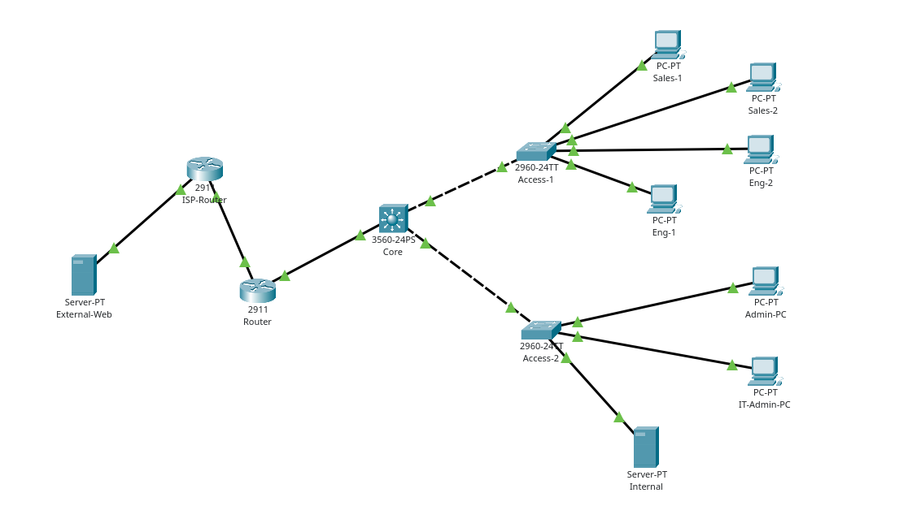

# Inside — Corporate Network Project

[Türkçe](README.md) | **English**

This project is a corporate network simulation configured in Cisco Packet Tracer 9.0.1. The network connects computers across three departments and an internal server. Network devices are accessible over SSH. HTTP access to a web server outside the company network passes through a simulated ISP.

## Project File and Credentials

Project file: [inside.pkt](inside.pkt)

| Credential | Value |
|---|---|
| SSH username | `netadmin` |
| SSH password | `admin` |
| Enable password | `admin` |

## Topology

| Device | IOS hostname | Model | Role |
|---|---|---|---|
| Core | HQ-Core | 3560-24PS | VLAN gateways, inter-VLAN routing, DHCP relay, and department ACLs |
| Access-1 | HQ-Access1 | 2960-24TT | Layer 2 connectivity for Sales and Engineering computers |
| Access-2 | HQ-Access2 | 2960-24TT | Administration, IT management, and server connectivity |
| Router | HQ-Router | 2911 | ISP connection, static routing, PAT, and zone-based firewall |
| ISP-Router | ISP-Router | 2911 | Routing between the company network and the external network |
| Internal | — | Server-PT | DHCP, DNS, and intranet |
| External-Web | — | Server-PT | HTTP server outside the company network |

Core handles inter-VLAN routing. Traffic to the external server follows Core → HQ-Router → ISP-Router.

### Ports and Trunk Connections

| Connection / port | Configuration |
|---|---|
| Core Fa0/1 ↔ Access-1 Gi0/1 | 802.1Q trunk; VLANs 20, 30, 99 |
| Core Fa0/2 ↔ Access-2 Gi0/1 | 802.1Q trunk; VLANs 10, 40, 99 |
| Access-1 Fa0/1–2 | Sales computer ports, VLAN 30 |
| Access-1 Fa0/3–4 | Engineering computer ports, VLAN 20 |
| Access-2 Fa0/1–2 | Admin-PC and IT-Admin-PC, VLAN 10 |
| Access-2 Fa0/3 | Internal, VLAN 40 |
| Core Gi0/1 ↔ HQ-Router Gi0/0 | Layer 3 connection, 10.255.0.0/30 |
| HQ-Router Gi0/1 ↔ ISP-Router Gi0/0 | ISP connection, 203.0.113.0/30 |
| ISP-Router Gi0/1 ↔ External-Web Fa0 | External network, 198.51.100.0/24 |

## VLAN and IP Addressing

| VLAN | Purpose | Subnet | Gateway (Core SVI) | DHCP address range |
|---:|---|---|---|---|
| 10 | Administration | 10.10.10.0/24 | 10.10.10.1 | 10.10.10.100–199 |
| 20 | Engineering | 10.10.20.0/24 | 10.10.20.1 | 10.10.20.100–199 |
| 30 | Sales | 10.10.30.0/24 | 10.10.30.1 | 10.10.30.100–199 |
| 40 | Servers | 10.10.40.0/24 | 10.10.40.1 | Static |
| 99 | Device management | 10.10.99.0/24 | 10.10.99.1 | Static |

| Device / interface | Static IP address |
|---|---|
| IT-Admin-PC | 10.10.10.10/24 |
| Internal | 10.10.40.10/24 |
| HQ-Access1 management SVI | 10.10.99.11/24 |
| HQ-Access2 management SVI | 10.10.99.12/24 |
| HQ-Core Gi0/1 | 10.255.0.1/30 |
| HQ-Router Gi0/0 | 10.255.0.2/30 |
| HQ-Router Gi0/1 | 203.0.113.1/30 |
| ISP-Router Gi0/0 | 203.0.113.2/30 |
| ISP-Router Gi0/1 | 198.51.100.1/24 |
| External-Web | 198.51.100.10/24 |

Internal uses default gateway 10.10.40.1; External-Web uses 198.51.100.1. The access switches send SSH responses back to IT-Admin-PC through 10.10.99.1.

## Routing and Services

- **Inter-VLAN routing:** Five SVIs on Core provide the VLAN gateways. Core forwards packets between these subnets with `ip routing` enabled.
- **Static routing:** Core sends traffic without a more specific route to HQ-Router at 10.255.0.2. HQ-Router's default route points to ISP-Router at 203.0.113.2. Return routes to the five company /24 subnets point through Core at 10.255.0.1.
- **DHCP:** Internal hosts separate DHCP pools for Administration, Engineering, and Sales. Each pool contains 100 IP addresses. Computers receive their IP address, subnet mask, default gateway, and DNS settings from this server. The DNS server is 10.10.40.10. Core relays DHCP requests using `ip helper-address 10.10.40.10` on the VLAN 10, 20, and 30 SVIs.
- **DNS:** An A record on Internal maps `intranet.inside.test` to 10.10.40.10.
- **HTTP:** The internal website runs at `http://intranet.inside.test`; the website outside the company network runs at `http://198.51.100.10`.
- **PAT:** HQ-Router Gi0/0 uses `ip nat inside`; Gi0/1 uses `ip nat outside`. The `NAT-SOURCES` ACL selects traffic from the VLAN 10, 20, and 30 subnets for translation. The `overload` option allows these computers to share 203.0.113.1 for external access. Server and device management subnets are excluded from this list.

The default `serverPool` is limited to 10.10.40.200 and one device.

## Access Policies

### Department ACLs

`SALES-POLICY` and `ENGINEERING-POLICY` filter traffic entering Core through the VLAN 30 and VLAN 20 SVIs respectively.

| Traffic from Sales and Engineering | Access |
|---|---|
| DHCP, UDP source 68 → destination 67 | Allowed |
| DNS to Internal, UDP/TCP 53 | Allowed |
| HTTP to Internal, TCP 80 | Allowed |
| ICMP Echo Request to own VLAN gateway and Internal | Allowed |
| HTTP to External-Web, TCP 80 | Allowed |
| Other routed IPv4 traffic | Blocked |

These rules apply only to the Sales and Engineering VLANs. They block traffic between the two departments, access to Administration and device management subnets, and external ICMP requests. They do not affect same-VLAN traffic.

### SSH Management

Core, both access switches, and HQ-Router use SSH v2 and local authentication. The standard `SSH-ADMIN` ACL permits incoming VTY connections only from IT-Admin-PC at 10.10.10.10.

| Device | Management IP address |
|---|---|
| HQ-Core | 10.10.99.1 |
| HQ-Access1 | 10.10.99.11 |
| HQ-Access2 | 10.10.99.12 |
| HQ-Router | 10.255.0.2 |

### Zone-Based Firewall

HQ-Router Gi0/0 belongs to `INSIDE`; Gi0/1 belongs to `OUTSIDE`. The `INSIDE-OUTSIDE` zone pair uses the `INSIDE-TO-OUTSIDE` policy:

| Class | Traffic | Action |
|---|---|---|
| OUTBOUND-ALLOWED | HTTP or ICMP | Inspect — track sessions and allow return traffic |
| class-default | Other traffic | Drop |

No zone pair permits new connections in the `OUTSIDE → INSIDE` direction. ACLs on the core switch block disallowed traffic before it reaches HQ-Router.

## Test Results

| Test | Result |
|---|---|
| VLAN membership, trunk lists, and SVI status | Correct port assignments; required VLANs carried over trunks; SVIs up/up |
| DHCP in all three departments | Computers received addresses from the correct subnets, with the expected mask, gateway, and DNS settings |
| Sales-1 and Eng-1 DHCP renewal after ACL deployment | Successful |
| Internal DNS and intranet | DNS resolution and HTTP access from both departments successful |
| Sales ↔ Engineering ping | Blocked in both directions |
| Sales/Engineering → IT-Admin-PC and switch management addresses | Blocked |
| IT-Admin-PC → three switches and HQ-Router SSH | Successful |
| Sales-1 → switch SSH; Admin-PC → router SSH | Refused |
| Core ↔ HQ-Router connectivity and return routes | Bidirectional connectivity and routing tables verified |
| IT-Admin-PC → External-Web ping | Successful; ICMP NAT entries present |
| Sales/Engineering → External-Web HTTP | Successful; TCP PAT entries and ACL matches present |
| HTTP access and IT-Admin-PC → External-Web ping with the firewall active | Successful; HTTP/ICMP inspection counters increased |
| External-Web → IT-Admin-PC, new ICMP request | Dropped by HQ-Router's firewall |
| Final check: External-Web HTTP access and SSH from IT-Admin-PC | Successful |
