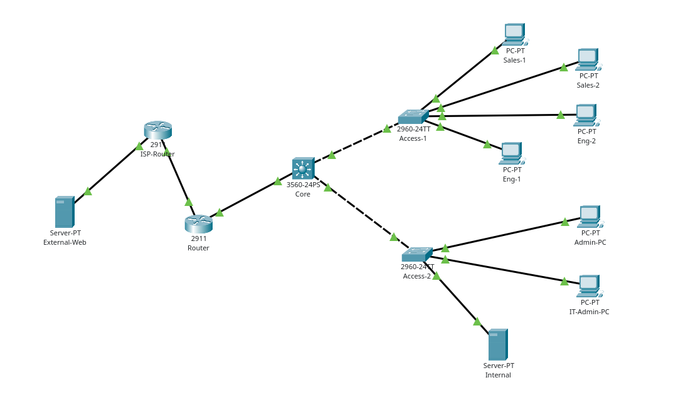

# Inside — Kurumsal Ağ Projesi

**Türkçe** | [English](README.en.md)

Bu proje, Cisco Packet Tracer 9.0.1 üzerinde yapılandırılmış bir kurumsal ağ simülasyonudur. Ağ, üç departmanın bilgisayarlarını ve şirket içindeki sunucuyu birbirine bağlar. Ağ cihazlarına SSH üzerinden erişilir. Şirket ağı dışındaki web sunucusuna HTTP erişimi, simüle edilmiş bir ISP üzerinden gerçekleşir.

## Proje Dosyası ve Giriş Bilgileri

Proje dosyası: [inside.pkt](inside.pkt)

| Bilgi | Değer |
|---|---|
| SSH kullanıcı adı | `netadmin` |
| SSH parolası | `admin` |
| Enable parolası | `admin` |

## Topoloji

| Cihaz | IOS adı | Model | Görevi |
|---|---|---|---|
| Core | HQ-Core | 3560-24PS | VLAN gateway'leri, inter-VLAN routing, DHCP relay ve departman erişim kontrolleri |
| Access-1 | HQ-Access1 | 2960-24TT | Satış ve Mühendislik bilgisayarlarının Layer 2 bağlantıları |
| Access-2 | HQ-Access2 | 2960-24TT | İdari İşler, IT yönetimi ve sunucu bağlantıları |
| Router | HQ-Router | 2911 | ISP bağlantısı, static routing, PAT ve zone-based firewall |
| ISP-Router | ISP-Router | 2911 | Şirket ağı ile dış ağ arasında routing |
| Internal | — | Server-PT | DHCP, DNS ve intranet |
| External-Web | — | Server-PT | Şirket ağı dışındaki HTTP sunucusu |

Inter-VLAN routing Core switch üzerinde gerçekleşir. Şirket ağı dışındaki sunucuya giden trafik Core switch → HQ-Router → ISP-Router yolunu izler.

### Portlar ve Trunk Bağlantıları

| Bağlantı / port | Yapılandırma |
|---|---|
| Core Fa0/1 ↔ Access-1 Gi0/1 | 802.1Q trunk; VLAN 20, 30, 99 |
| Core Fa0/2 ↔ Access-2 Gi0/1 | 802.1Q trunk; VLAN 10, 40, 99 |
| Access-1 Fa0/1–2 | Satış bilgisayarlarının bağlı olduğu portlar, VLAN 30 |
| Access-1 Fa0/3–4 | Mühendislik bilgisayarlarının bağlı olduğu portlar, VLAN 20 |
| Access-2 Fa0/1–2 | Admin-PC ve IT-Admin-PC, VLAN 10 |
| Access-2 Fa0/3 | Internal, VLAN 40 |
| Core Gi0/1 ↔ HQ-Router Gi0/0 | Layer 3 bağlantı, 10.255.0.0/30 |
| HQ-Router Gi0/1 ↔ ISP-Router Gi0/0 | ISP bağlantısı, 203.0.113.0/30 |
| ISP-Router Gi0/1 ↔ External-Web Fa0 | Dış ağ, 198.51.100.0/24 |

## VLAN ve IP Adresleme

| VLAN | Kullanım amacı | Subnet | Gateway (Core switch SVI) | DHCP adres aralığı |
|---:|---|---|---|---|
| 10 | İdari İşler | 10.10.10.0/24 | 10.10.10.1 | 10.10.10.100–199 |
| 20 | Mühendislik | 10.10.20.0/24 | 10.10.20.1 | 10.10.20.100–199 |
| 30 | Satış | 10.10.30.0/24 | 10.10.30.1 | 10.10.30.100–199 |
| 40 | Sunucular | 10.10.40.0/24 | 10.10.40.1 | Statik |
| 99 | Cihaz yönetimi | 10.10.99.0/24 | 10.10.99.1 | Statik |

| Cihaz / arayüz | Statik IP adresi |
|---|---|
| IT-Admin-PC | 10.10.10.10/24 |
| Internal | 10.10.40.10/24 |
| HQ-Access1 yönetim SVI'sı | 10.10.99.11/24 |
| HQ-Access2 yönetim SVI'sı | 10.10.99.12/24 |
| HQ-Core Gi0/1 | 10.255.0.1/30 |
| HQ-Router Gi0/0 | 10.255.0.2/30 |
| HQ-Router Gi0/1 | 203.0.113.1/30 |
| ISP-Router Gi0/0 | 203.0.113.2/30 |
| ISP-Router Gi0/1 | 198.51.100.1/24 |
| External-Web | 198.51.100.10/24 |

Internal sunucusu 10.10.40.1, External-Web sunucusu 198.51.100.1 adresini default gateway olarak kullanır. Access switch'ler, IT-Admin-PC'ye dönen SSH yanıtlarını 10.10.99.1 üzerinden gönderir.

## Yönlendirme ve Servisler

- **Inter-VLAN routing:** Core switch üzerindeki beş SVI, ilgili VLAN'ların gateway'leridir. Core switch, `ip routing` ayarıyla bu subnet'ler arasında paket iletir.
- **Static routing:** Core switch, hedef için daha özel bir rota bulunmadığında trafiği 10.255.0.2 adresindeki HQ-Router'a gönderir. HQ-Router'ın default route'u ise 203.0.113.2 adresindeki ISP-Router'ı gösterir. HQ-Router, şirketin beş /24 subnet'ine dönüş trafiğini 10.255.0.1 üzerinden Core switche iletir.
- **DHCP:** Internal sunucusunda İdari İşler, Mühendislik ve Satış için ayrı DHCP pool'ları bulunur. Her pool 100 IP adresi içerir. Bilgisayarlar IP adresi, subnet mask, default gateway ve DNS bilgilerini bu sunucudan alır. DNS sunucusu 10.10.40.10'dur. Core switch, VLAN 10, 20 ve 30 SVI'larındaki `ip helper-address 10.10.40.10` ayarıyla DHCP isteklerini sunucuya iletir.
- **DNS:** Internal sunucusundaki A kaydı, `intranet.inside.test` adını 10.10.40.10 IP adresiyle eşleştirir.
- **HTTP:** Şirket içi web sitesi `http://intranet.inside.test`, şirket ağı dışındaki web sitesi ise `http://198.51.100.10` adresinde çalışır.
- **PAT:** HQ-Router üzerinde Gi0/0, `ip nat inside`; Gi0/1 ise `ip nat outside` ayarını kullanır. `NAT-SOURCES` listesi, VLAN 10, 20 ve 30 subnet'lerinden gelen trafiği adres çevirisi için seçer. `overload` ayarı sayesinde bu bilgisayarlar dış ağlara erişirken 203.0.113.1 adresini paylaşır. Sunucu ve cihaz yönetimi subnet'leri bu listeye dahil değildir.

Varsayılan `serverPool`, 10.10.40.200 adresi ve tek cihazla sınırlıdır.

## Erişim Politikaları

### Erişim Kontrolleri (ACL)

`SALES-POLICY` ve `ENGINEERING-POLICY`, sırasıyla VLAN 30 ve VLAN 20 SVI'larından Core switche giren trafiği denetler.

| Satış ve Mühendislikten gelen trafik | Erişim |
|---|---|
| DHCP, UDP kaynak 68 → hedef 67 | İzin verilir |
| Internal sunucusuna DNS, UDP/TCP 53 | İzin verilir |
| Internal sunucusuna HTTP, TCP 80 | İzin verilir |
| Kendi VLAN gateway'ine ve Internal sunucusuna ICMP Echo Request | İzin verilir |
| External-Web sunucusuna HTTP, TCP 80 | İzin verilir |
| Diğer yönlendirilen IPv4 trafiği | Engellenir |

Bu erişim kuralları yalnızca Satış ve Mühendislik VLAN'larında geçerlidir. İki departman arasındaki trafiği, İdari İşler ve cihaz yönetimi subnet'lerine erişimi ve dış ağlara gönderilen ICMP isteklerini engeller. Aynı VLAN içindeki trafiği etkilemez.

### SSH Yönetimi

Core switch, iki access switch ve HQ-Router üzerinde SSH v2 ve local authentication etkindir. `SSH-ADMIN` erişim listesi, VTY hatlarına yalnızca 10.10.10.10 adresindeki IT-Admin-PC'den gelen bağlantılara izin verir.

| Cihaz | Yönetim IP adresi |
|---|---|
| HQ-Core | 10.10.99.1 |
| HQ-Access1 | 10.10.99.11 |
| HQ-Access2 | 10.10.99.12 |
| HQ-Router | 10.255.0.2 |

### Zone-Based Firewall

HQ-Router üzerinde Gi0/0 `INSIDE`, Gi0/1 ise `OUTSIDE` zone'una bağlıdır. `INSIDE-OUTSIDE` zone-pair'i, `INSIDE-TO-OUTSIDE` policy'sini kullanır:

| Class | Trafik | İşlem |
|---|---|---|
| OUTBOUND-ALLOWED | HTTP veya ICMP | Inspect — session takibi ve dönüş trafiğine izin |
| class-default | Diğer trafik | Drop |

`OUTSIDE → INSIDE` yönünde yeni bağlantılara izin veren bir zone-pair yoktur. Core switch üzerindeki erişim kuralları, izin verilmeyen trafiği HQ-Router'a ulaşmadan engeller.

## Test Sonuçları

| Test | Sonuç |
|---|---|
| VLAN üyelikleri, trunk listeleri ve SVI durumları | Portlar doğru VLAN'lara ait; gerekli VLAN'lar trunk üzerinden geçiyor; SVI'lar up/up |
| Üç departmanda DHCP | Bilgisayarlar doğru subnet'ten IP adresi, maske, gateway ve DNS bilgisi aldı |
| Erişim kuralları sonrasında Sales-1 ve Eng-1 DHCP yenilemesi | Başarılı |
| Şirket içi DNS ve intranet | DNS sorgusu ve iki departmandan HTTP erişimi başarılı |
| Satış ↔ Mühendislik ping | İki yönde de engellendi |
| Satış/Mühendislik → IT-Admin-PC ve switch yönetim adresleri | Engellendi |
| IT-Admin-PC → üç switch ve HQ-Router SSH | Başarılı |
| Sales-1 → switch SSH; Admin-PC → router SSH | Reddedildi |
| Core switch ↔ HQ-Router bağlantısı ve dönüş rotaları | Çift yönlü erişim ve yönlendirme tabloları doğrulandı |
| IT-Admin-PC → External-Web ping | Başarılı; ICMP NAT kayıtları mevcut |
| Satış/Mühendislik → External-Web HTTP | Başarılı; TCP PAT kayıtları ile erişim kuralı eşleşmeleri mevcut |
| Güvenlik duvarı etkinken HTTP erişimi ve IT-Admin-PC'den External-Web'e ping | Başarılı; HTTP/ICMP inspection counter değerleri arttı |
| External-Web → IT-Admin-PC, yeni ICMP isteği | HQ-Router güvenlik duvarı isteği düşürdü |
| Son kontrol: External-Web HTTP erişimi ve IT-Admin-PC üzerinden SSH | Başarılı |
